

 

  

<a href="https://x.com/joel_depin"><b>Follow on X</b></a> &nbsp;·&nbsp; <a href="#what-i-build-for-clients"><b>For clients</b></a> &nbsp;·&nbsp; <a href="#engineering-projects"><b>Engineering</b></a> &nbsp;·&nbsp; <a href="#building"><b>Building</b></a>

## What I build for clients

Working tools for real business problems. Each one comes with source code, a README with a quickstart and a test suite, and I can adapt it to your data.

<table>
<tr>
<td width="50%" valign="top">
<a href="https://github.com/joel819/catalog-chat-assistant">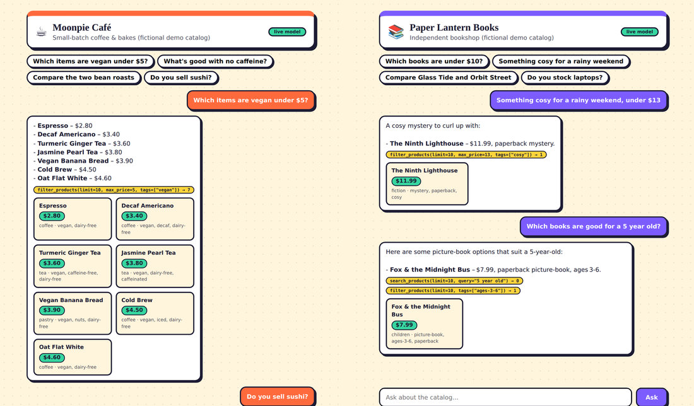</a>
 
<h3><a href="https://github.com/joel819/catalog-chat-assistant">catalog-chat-assistant</a></h3>
A shopping assistant that answers only from a shop's own product catalog: recommendations, comparisons and "which items are vegan under $5?". Says so when something isn't in the catalog, and each shop's data stays separate.
 <b>Chatbot · tool calling · ChromaDB · multi-tenant</b>
</td>
<td width="50%" valign="top">
<a href="https://github.com/joel819/docs-rag-chatbot">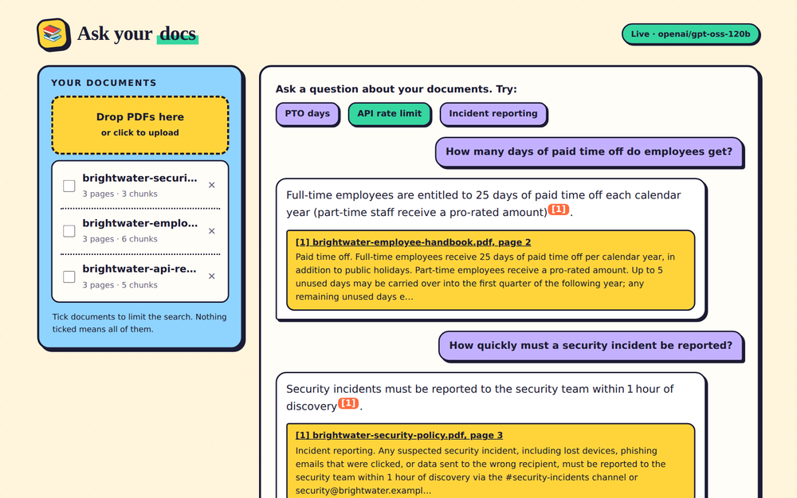</a>
 
<h3><a href="https://github.com/joel819/docs-rag-chatbot">docs-rag-chatbot</a></h3>
Answers questions over company documents, with citations to the source page. Click a citation and the PDF opens at that page. A question the documents don't cover gets an honest "I couldn't find that".
 <b>RAG · ChromaDB · FastAPI · Groq</b>
</td>
</tr>
<tr>
<td width="50%" valign="top">
<a href="https://github.com/joel819/invoice-extractor">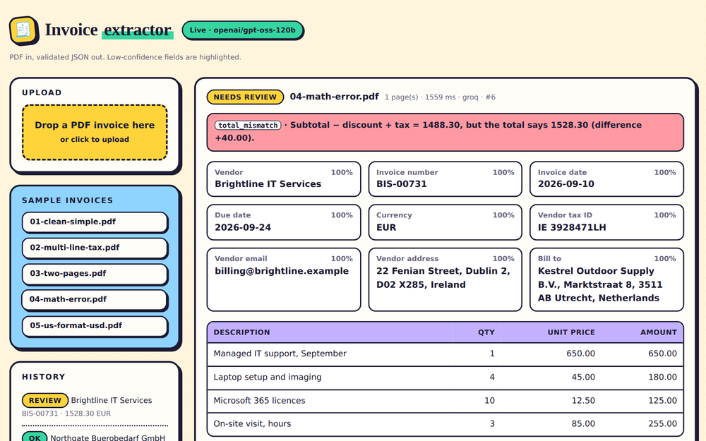</a>
 
<h3><a href="https://github.com/joel819/invoice-extractor">invoice-extractor</a></h3>
Turns messy PDF invoices into validated structured JSON. Confidence on every field, and arithmetic errors are flagged for review, never silently fixed.
 <b>FastAPI · Pydantic · LLM extraction · validation</b>
</td>
<td width="50%" valign="top">
<a href="https://github.com/joel819/product-data-extractor">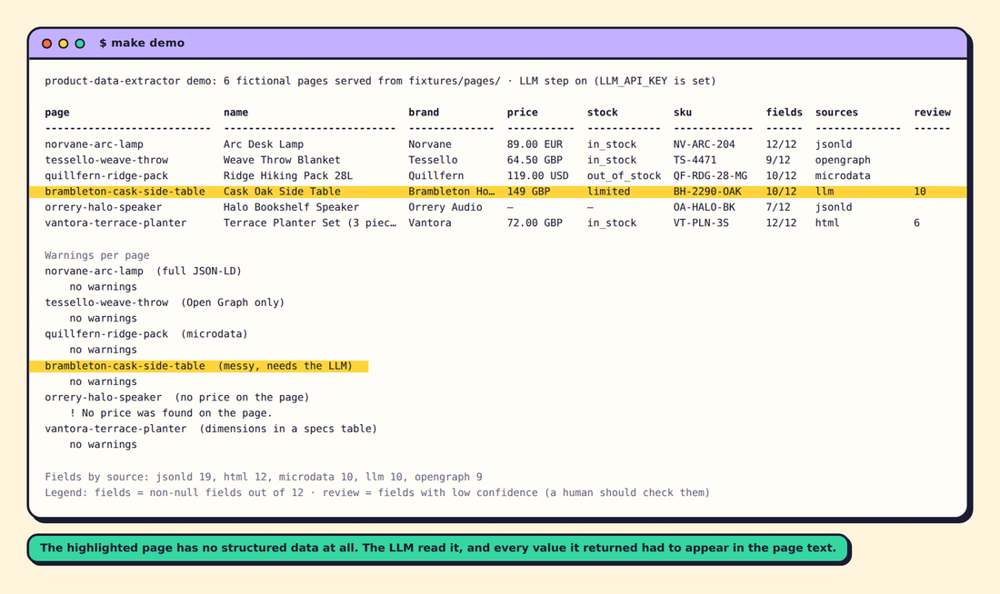</a>
 
<h3><a href="https://github.com/joel819/product-data-extractor">product-data-extractor</a></h3>
Paste a product page URL and get clean structured data, optionally filled into a Google Sheets row. Standard page data first, an LLM only for gaps, and every field shows its source.
 <b>Web extraction · schema.org · Google Sheets</b>
</td>
</tr>
<tr>
<td width="50%" valign="top">
<a href="https://github.com/joel819/web-flow-bot">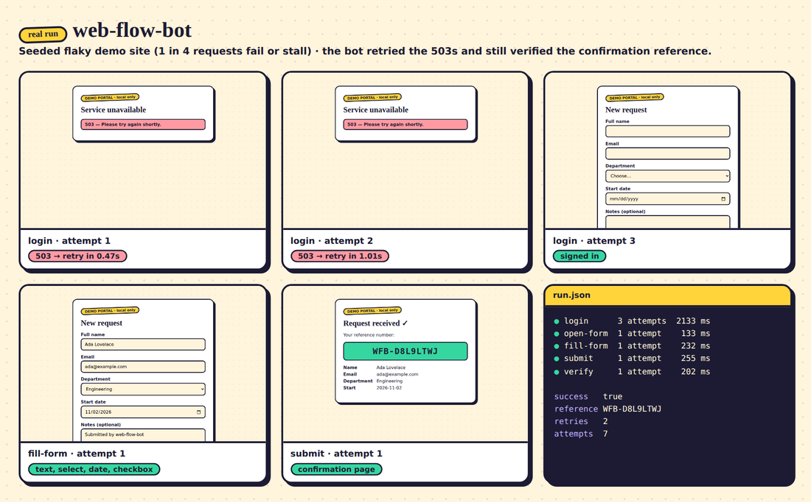</a>
 
<h3><a href="https://github.com/joel819/web-flow-bot">web-flow-bot</a></h3>
Playwright bot that logs in, fills a form, submits it and verifies the confirmation number. Retries with backoff, a screenshot of every attempt and a JSON run log.
 <b>Playwright · retries · Docker · pytest</b>
</td>
<td width="50%" valign="top">
<a href="https://github.com/joel819/llm-cost-router">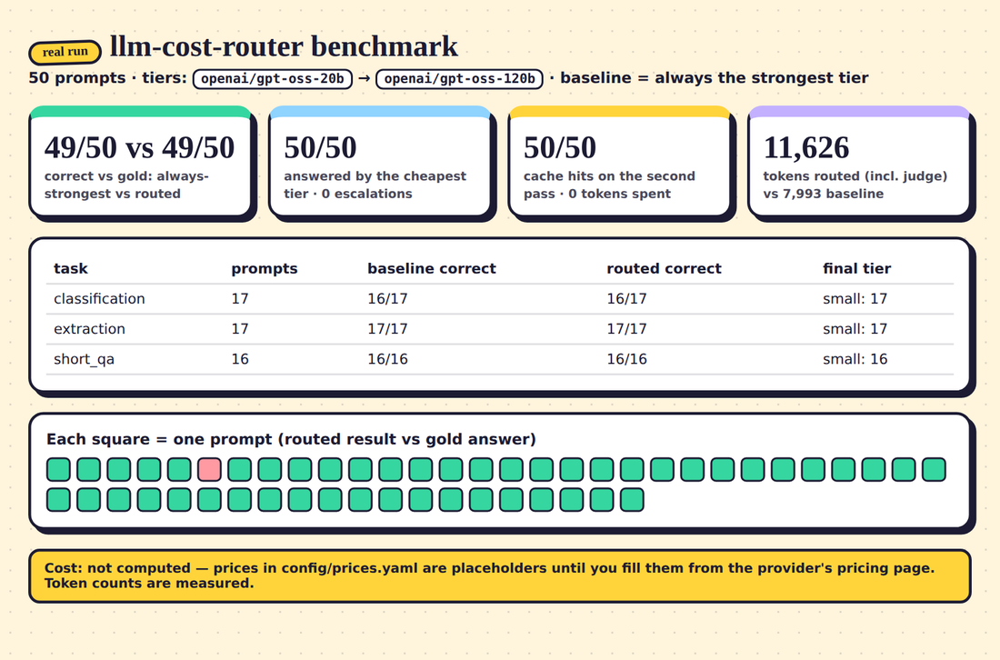</a>
 
<h3><a href="https://github.com/joel819/llm-cost-router">llm-cost-router</a></h3>
Sends each prompt to the cheapest model that passes a quality check, escalates only on failure and caches repeats. Prices come from config, and the benchmark reports only what a real run measured.
 <b>OpenAI-compatible APIs · routing · caching</b>
</td>
</tr>
</table>

## Engineering projects

How I build the foundations: auth and billing, safety for AI agents, protocols and tool use. These show how I work rather than a product to buy.

<table>
<tr>
<td width="33%" valign="top">
<a href="https://github.com/joel819/fastapi-saas-backend">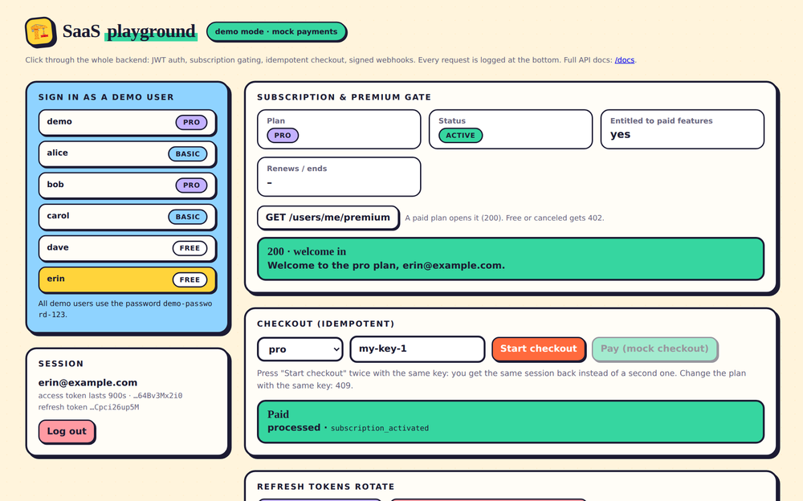</a>
 
<h3><a href="https://github.com/joel819/fastapi-saas-backend">fastapi-saas-backend</a></h3>
JWT auth with rotating refresh tokens, subscriptions, verified and idempotent Stripe webhooks, rate limiting and a full test suite.
 <b>FastAPI · JWT · Stripe · SQLAlchemy</b>
</td>
<td width="33%" valign="top">
<a href="https://github.com/joel819/agent-spend-guard">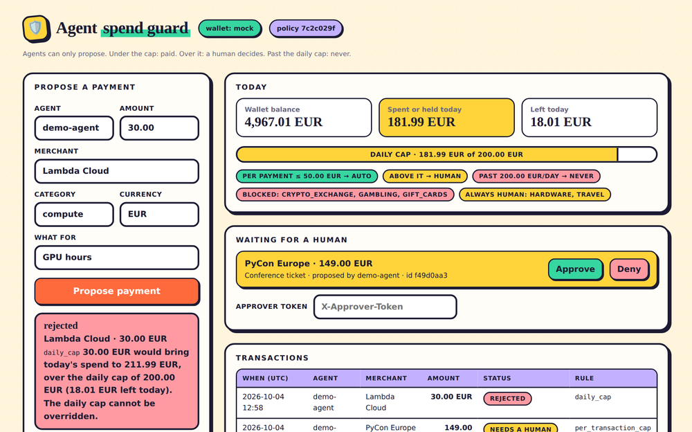</a>
 
<h3><a href="https://github.com/joel819/agent-spend-guard">agent-spend-guard</a></h3>
Spend limits and human approval for AI agents that handle funds, with a tamper-evident audit log.
 <b>FastAPI · policy as config · audit log</b>
</td>
<td width="33%" valign="top">
<a href="https://github.com/joel819/mcp-server-template">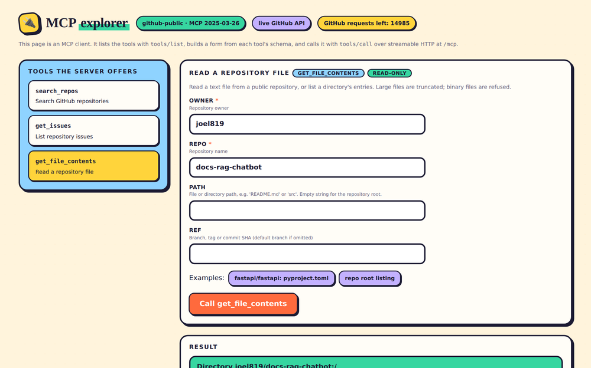</a>
 
<h3><a href="https://github.com/joel819/mcp-server-template">mcp-server-template</a></h3>
An MCP server exposing a real API as a tool for any agent. Streamable HTTP and stdio from one definition.
 <b>MCP · GitHub API · stdio</b>
</td>
</tr>
<tr>
<td width="33%" valign="top">
<a href="https://github.com/joel819/support-agent">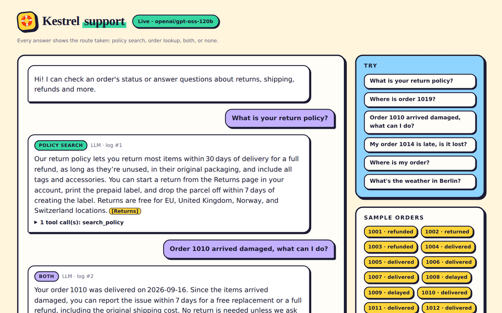</a>
 
<h3><a href="https://github.com/joel819/support-agent">support-agent</a></h3>
Support agent combining document search with live order lookups via tool calling. Every answer shows its route and tool calls.
 <b>Tool calling · RAG · routing log</b>
</td>
<td width="33%" valign="top">
<a href="https://github.com/joel819/sandboxed-agent">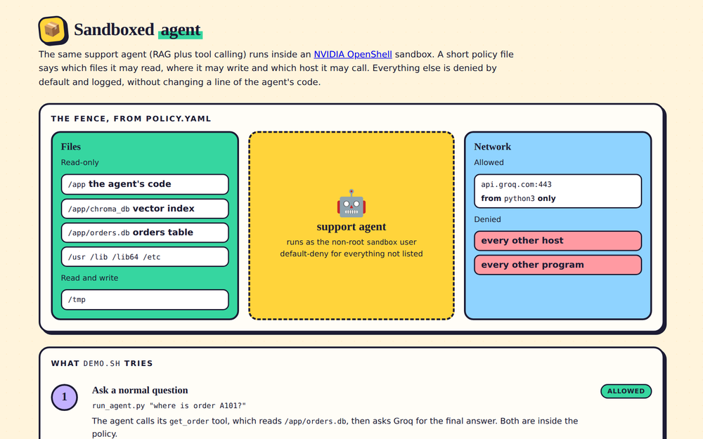</a>
 
<h3><a href="https://github.com/joel819/sandboxed-agent">sandboxed-agent</a></h3>
Runs support-agent inside an NVIDIA OpenShell sandbox with an allow-list policy for files and network.
 <b>OpenShell · policy as code · Docker</b>
</td>
<td></td>
</tr>
</table>

## How I build

<table>
<tr>
<td width="33%" valign="top">
<b>Easy to run</b> 
Each README has a short quickstart, and the AI projects have a demo mode or a free-tier setup, so you can see them working in minutes.
</td>
<td width="33%" valign="top">
<b>Tested offline</b> 
Test suites that need no keys, no model download and no network, so they run anywhere.
</td>
<td width="33%" valign="top">
<b>Honest about failure</b> 
Low-confidence flags instead of silent fixes, hard rejects with the numbers, "I couldn't find that" instead of a guess.
</td>
</tr>
</table>

## Building

**SoverGrid**: a routing layer for decentralized compute.

## Contact

[X (@joel_depin)](https://x.com/joel_depin)
